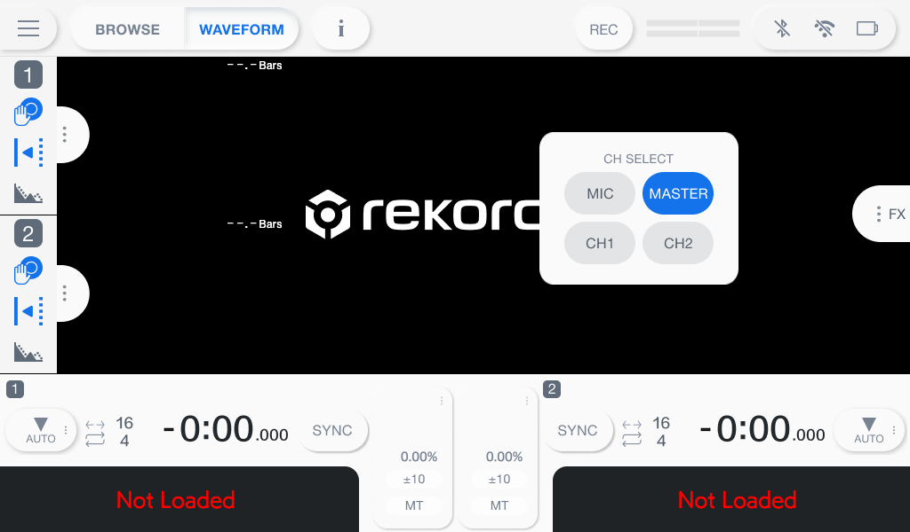
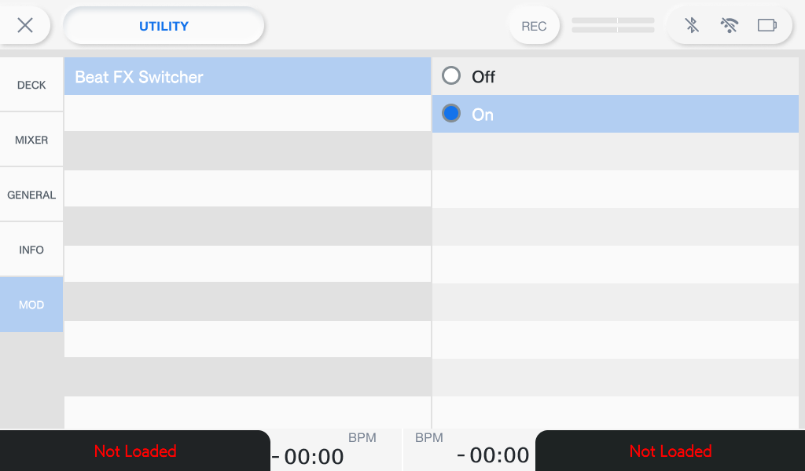

# OMNIS-DUO Mods

> **⚠️ Work in Progress & Firmware Notice:** This project is an active work in progress. Currently, it is built and tested for **Firmware v1.23 only**. It has **not** been tested on **v2.00** or any other firmware version.

> **⚠️ Disclaimer:** Use at your own risk. I am not responsible for any damage, data loss, or unexpected behavior on your hardware or computer.

---

## Overview

Community USB mods for the **AlphaTheta / Pioneer DJ OMNIS-DUO** (Firmware **v1.23**).

* **Ephemeral (RAM-only):** The mod is loaded into RAM at runtime via USB—no firmware flashing or permanent partition writes are performed.
* **Resets on Power Cycle:** Powering the unit off and back on completely clears the mod and returns the unit to 100% factory stock.

---

## Beat FX Channel Quick-Select (`mods/beat-fx`)

Maps physical hardware buttons to cycle the Beat FX target channel in real time without digging through touchscreen menus during a live set.

### Controls

| Shortcut | Action |
|---|---|
| **`SHIFT` + Headphone `CUE 2`** (Deck 1 or 2) | Next Beat FX Channel (`CH1` → `CH2` → `MIC` → `MASTER`) |
| **`SHIFT` + Headphone `CUE 1`** (Deck 1 or 2) | Previous Beat FX Channel |

* **CUE Suppression:** Headphone cueing is masked while `SHIFT` is held so you do not accidentally toggle your monitor cues.
* **Auto-Dismiss Drawer:** Pops out the **CH SELECT** panel for visual confirmation and closes automatically after 3 seconds of inactivity.
* **Utility Menu Toggle:** Adds a **MOD** section in `UTILITY` so you can toggle the Beat FX mod **On** or **Off**.

### Screenshots

#### Mod in Action (`CH SELECT` Drawer)


#### Mod Options (`UTILITY` → `MOD`)


---

## What You Need (2 USB Sticks Required)

You will need **two separate USB drives**:

1. **USB Stick #1 — Dedicated MOD STICK:** A spare USB drive (any small capacity works) dedicated solely to flashing `modstick.iso`. Flashing overwrites the entire drive with the raw mod image, so **do not** use your music drive—it cannot store tracks at the same time.
2. **USB Stick #2 — Regular Music Stick:** Your normal rekordbox / music USB drive, which you plug in **after** loading the mod and unplugging the **MOD STICK**.

---

## Step 1: Flash the MOD STICK (USB Stick #1)

Download `modstick.iso` from the latest [GitHub Release](https://github.com/sushix2/omnis-duo-mods/releases) and write it to your dedicated **MOD STICK**.

### macOS (`diskutil` + `dd`)

1. Plug in your spare **MOD STICK** USB drive and find its disk identifier (e.g., `disk4`):
   ```bash
   diskutil list
   ```
   *(Double-check the size and name so you pick the right drive—`dd` will overwrite the entire target disk!)*
2. Unmount the **MOD STICK** (replace `disk4` with your disk):
   ```bash
   diskutil unmountDisk /dev/disk4
   ```
3. Flash `modstick.iso` to the raw disk (`rdisk4`) and sync:
   ```bash
   sudo dd if=modstick.iso of=/dev/rdisk4 bs=1m status=progress && sync
   ```
4. Eject the **MOD STICK**:
   ```bash
   diskutil eject /dev/disk4
   ```

### Windows / Linux
* **Linux:** Use `lsblk` to find your **MOD STICK** (e.g. `/dev/sdX`), unmount it, and run `sudo dd if=modstick.iso of=/dev/sdX bs=1M status=progress && sync`.
* **Windows:** Use Rufus (select **"Write in DD Image mode"**) or balenaEtcher.

---

## Step 2: Load the Mod & Switch to Your Regular USB Stick

1. **Power on the unit first** (with no USB drives inserted) and wait for it to boot normally.
2. **Plug in your MOD STICK** (USB Stick #1).
3. The unit will **reboot/restart** its interface, and a **"Format USB"** popup message will appear on screen (this is normal because the **MOD STICK** holds a raw image). Dismiss the popup and **unplug the MOD STICK**.
4. Open the **UTILITY** menu → **MOD**, and toggle **Beat FX Switcher** (**Off** / **On**) so it is **On**.
5. **Plug in your regular music USB stick** (USB Stick #2) and play like normal!

*(Remember: The mod is temporary and resets whenever you power-cycle the unit. Just repeat Step 2 with your MOD STICK after booting if you want to enable it again.)*

---

## Recovery (If Anything Freezes)

If the screen ever freezes or something goes wrong:
1. **Remove the USB drive** from the unit.
2. **Hold down `POWER` + `SHIFT` for 10 seconds**—the unit will force-reboot cleanly back to stock firmware.

---

## Repository Contents

```text
omnis-duo-mods/
├── README.md
├── LICENSE
├── assets/
│   ├── mod_in_action.png
│   └── mod_options.png
└── mods/
    └── beat-fx/
        ├── README.md
        └── libfxswitcher.c  # C source code for the button hook mod
```
